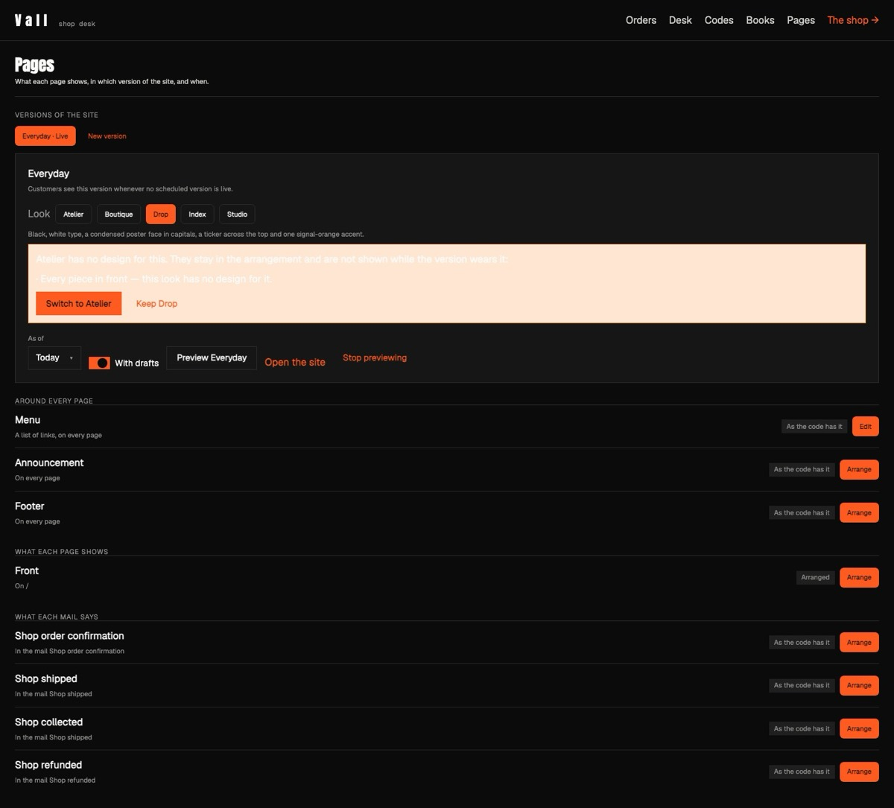

# Osysharp.Site.Looks

The general site contract for **looks** — the block TYPES any consumer-facing site has, as a shape and nothing more:
what a hero, a quote or the footer's words hold, never how they look.

**Looks come in three layers, and this kit is the bottom one:**

```text
  a LOOK                 Osysharp.Shop.Looks.Drop, .Rail …        how it all looks: the frame, the pages, the theme
                         (one kit each)                           and fonts, a design of each type, blocks of its own
        draws ↓ both
  a CATEGORY contract    Osysharp.Shop.Looks (inside the shop)    what a SHOP has: a row of products, the shelves,
                         a café's, a salon's … beside it          the store's frame, front page, listing, piece's page
        on top of ↓
  the SITE contract      Osysharp.Site.Looks — this kit            what ANY site has: a hero, a quote, a sign-up,
                                                                  a banner, the strip across the top, the footer
```

A contract is an `abstract component` — parameters, no body. A look kit (`look Atelier { … }` in its own namespace)
designs each type with exactly the contract's parameters, checked like a class against an interface. Staff pick a look
per version of the site at the page desk (`/staff/pages`); what they arranged is stored as the TYPE and its values, so
switching the look redraws the same words and photographs in the new design. Orders, stock, customers and the
arrangements stay put; the frame, the pages, every block's design, the theme and the fonts move.



**The types** (each an `abstract component` with `[Block]`; its parameters are the fields staff fill in):

| type | what staff fill in |
|---|---|
| `Hero` | a headline, words under it, a photograph and a second one, a button and where it goes, a ground |
| `PictureWithWords` | a photograph, a heading, words, which side the photograph is on, a ground |
| `Quote` | what they said, who said it, a ground |
| `SignUp` | the newsletter's heading, words and button |
| `Banner` | a strip of words across the page, a link, a ground |
| `PhotoGallery` | a heading and up to four photographs |
| `Announcement` | the strip across the top of every page |
| `FooterWords`, `FooterLink`, `OpeningHours`, `Address`, `FooterSignUp` | the footer |

The category contract on top of it carries what this one cannot: the shop's (`Osysharp.Shop.Looks`, inside
`Osysharp.Shop`) names the shop's data — a product, a shelf — so it lives in the shop kit. A café's or a salon's would sit
beside it the same way, on this same site contract, so one design idea can serve a shop, a café and a barber alike.
The shop kit's plain design of each type here and of its own two is the default design: what a store
without a look draws (Grounds & Grapes, Rust & Chrome), and what a look with no design of its own of a type draws, in
that look's theme.

**Use it** — in a look kit:

```osy
namespace MyStore.Looks.Meadow;
using Osysharp.Site.Looks;

look Meadow { Label = "Meadow"; Theme = MeadowTheme; }
component MeadowHero(string title, Markdown words = "", Picture photo = "", Picture second = "", string button = "Shop now",
                     PageLink link = "/", Color ground = Colors.Surface) : Hero { render { … } }
```

A design takes exactly the contract's parameters, or the compiler refuses it naming the difference. Building a whole
look — the manifest, the theme, the seven parts of a store, the fonts, a block of its own, seeing it with
`osy test --pixels` — is `osy docs ui-building-a-look`; looks, contracts and the desk are `osy docs ui-looks`. [Ten
complete designs of a shop](https://osyrin.com/templates/shop/#looks): five worn by the Vall fashion store and five by the Second Round thrift store.

Its tests are a florist with two looks of its own: the look the app names, a switch redrawing the same arrangement,
what a look leaves behind.

## Examples

Taken from this package's own tests, which compile and run on every release.

```osy
using Osysharp.Blocks;

[Test(Florist)]
void a_look_name_the_app_does_not_have_is_refused() {
  runas (Anna) {
    Assert.Equal("The app has no look called dusk.", SetLook(MainVersion().Id, "dusk"));
    Assert.Equal("meadow", SiteLook().Look);
  }
}
```

From [`tests/looks.test.osy`](tests/looks.test.osy).

```osy
using Osysharp.Blocks;

[Test(Florist)]
void each_block_says_which_looks_draw_it() {
  runas (Anna) {
    var bouquet = BlockTypes().Single(b => b.Name == "Bouquet");
    Assert.False(bouquet.EveryLook);
    Assert.Equal(3, bouquet.Looks.Count);   // Meadow, Night and Frost
    var quote = BlockTypes().Single(b => b.Name == "Saying");
    Assert.Equal(1, quote.Looks.Count);
    Assert.Equal("meadow", quote.Looks[0]);
    var pressed = BlockTypes().Single(b => b.Name == "Florist.Looks.Meadow.Pressed");
    Assert.Equal("meadow", pressed.Looks[0]);
    // One region, "front", declared by each look that draws a front — Frost draws none — and the version's look
    // decides what it allows and its default.
    Assert.Equal(2, SiteRegions().Count(r => r.Name == "front"));
    Assert.Contains("Florist.Looks.Meadow.Pressed", SiteRegions().Single(r => r.Name == "front" && r.Look == "meadow").Allow);
    Assert.Equal("/", SiteRegions().Single(r => r.Name == "front" && r.Look == "night").Page);
  }
}
```

From [`tests/looks.test.osy`](tests/looks.test.osy).

```osy
using Osysharp.Blocks;

[Test(Florist)]
void the_general_contract_is_in_the_catalog_as_block_types() {
  runas (Anna) {
    var hero = BlockTypes().Single(b => b.Name == "Osysharp.Site.Looks.Hero");
    Assert.Equal("Hero", hero.Label);
    Assert.Equal(7, hero.Params.Count);
    Assert.Equal(BlockParamKind.Picture, hero.Params.Single(p => p.Name == "photo").Kind);
    // No look of this app draws it — a look kit would.
    Assert.False(hero.EveryLook);
    Assert.Equal(0, hero.Looks.Count);
    foreach (var name in new List<string> { "PictureWithWords", "Quote", "SignUp", "Banner", "PhotoGallery", "Announcement",
                                            "FooterWords", "FooterLink", "OpeningHours", "Address", "FooterSignUp" }) {
      Assert.Equal(1, BlockTypes().Count(b => b.Name == "Osysharp.Site.Looks." + name));
    }
  }
}
```

From [`tests/looks.test.osy`](tests/looks.test.osy).

## Learn more

- [The Osysharp.Site.Looks reference](https://osysharp.com/reference/ui/looks/)
- [Osysharp.Site.Looks in the package catalogue](https://osysharp.com/packages/#osysharp-site-looks)
- [The Osy# reference](https://osysharp.com/reference/) — the language, the runtime and every kit
- [`llms-full.txt`](https://osysharp.com/llms-full.txt) — the whole reference and specification as one Markdown file, for a coding agent

## Licence

MIT — see [`LICENSE`](LICENSE).
